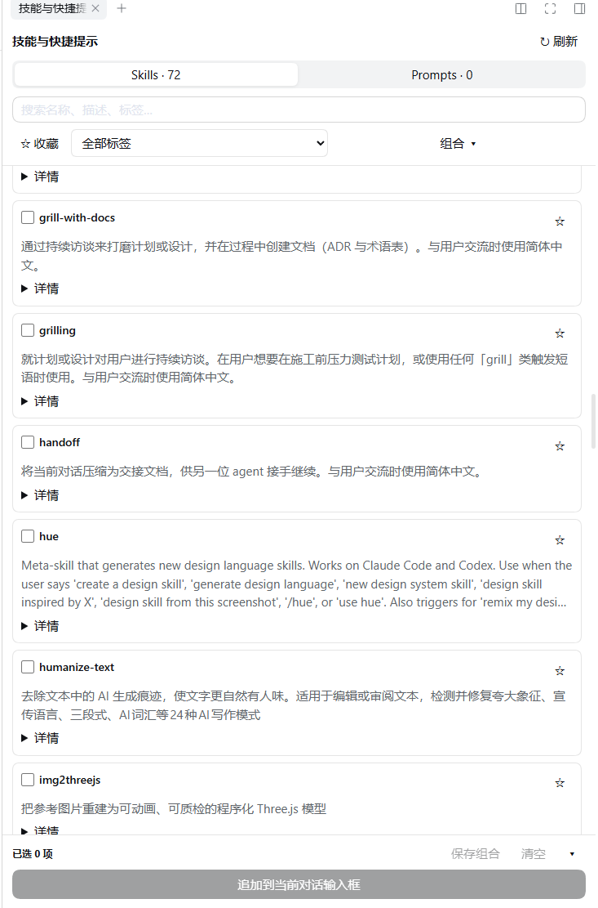

# dsh-skill-prompt-injector

**English** | [中文](README.zh.md)

**Search, pin, combine and inject skills & prompts into the current conversation — from the DSH right sidebar.**



## Features

- **Skills catalog** — mirrors the live DSH skill registry of the current session (workspace and agent-preset aware), with search across name, description, body and tags.
- **Prompts** — create, edit and delete your own reusable snippets.
- **Tags & favorites** — both entry kinds can be favorited and tagged locally.
- **Combinations** — save a named set of skills + prompts, load it later, rename it, or update it in place. Combinations always reference the latest prompt body.
- **One-click inject** — appends the selection to the current composer as plain text, keeping your draft, references and attachments; `Ctrl+Z` undoes the insertion in one step.
- **Never sends for you** — injection only fills the draft; you review and send.
- **Kept mounted** — lives in the right sidebar beside the shipped tabs, so switching sessions does not tear it down.

## Requirements

- DeepSeek Harness `>=0.2.1-rc.3 <0.2.2` (declared as `engines.dsh`)
- A DSH build that provides the right sidebar slot `sidebar.right.pane.tab`

## Install

The prebuilt `lib/` artifacts are committed, so installing needs no build step.

```powershell
git clone https://github.com/Larliers/dsh-skill-prompt-injector.git
dsh plugin --profile <profile> add link:<absolute-path-to-clone>
```

Or open **Plugins** in DSH and install the package directory as a local bundle.

Restart DSH afterwards so both the Host and the Client side load the new artifacts.

## Usage

1. Open the right sidebar and pick **Skills & prompts** (技能与快捷提示).
2. Toggle entries in the **Skills** tab; switch to **Prompts** to manage snippets.
3. Use **Combinations** to save or load a named set.
4. Press **Append to composer** (追加到当前对话输入框), review the draft, then send.

Skills resolve from the session's workspace and agent preset; the body itself is loaded by DSH's native `/skill-name` mechanism after you send. Dragging only changes injection order — it does not build a serial workflow.

## Data

Favorites, tags, combinations and prompts live outside the package, under `$DSH_HOME/skill-prompt-injector/` (default `~/.dsh/skill-prompt-injector/`):

- `prompts.json` — titles, bodies, tags and favorites of your snippets
- `library.json` — skill tags/favorites, and combination references and order

Both files carry `schemaVersion: 1` plus a Host-maintained `revision`; edit them through the UI. Writes are version-checked, serialized and atomic, and `.bak` keeps the previous valid file. The plugin never rewrites your `SKILL.md` files.

Point `dataDirectory` in the plugin Config elsewhere if you prefer another location.

## Development

```powershell
npm ci
npm run typecheck
npm test
npm run build
```

Output: `lib/index.js` (Host) and `lib/client.js` (Client). The two halves talk over the native Typert Remote channel — no extra server or MCP.

## License

[MIT](LICENSE) © 2026 Larliers
